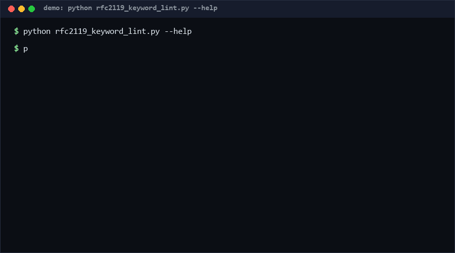

# rfc2119-keyword-lint

A linter for RFC 2119 normative keywords in specification documents. It
verifies the boilerplate sentence exists up front, that keywords are used
deliberately (uppercase only), that none are swallowed into longer tokens
(MUSTARD, OPTIONALLY), that keyword lines are complete sentences, and that
SHOULD statements carry justification — then reports rule-id'd findings.
Pure standard library. *No direct equivalent found as of 2026-10-13.*

<p align="center"></p>

## Problem

Specs that say "must" in lowercase next to "MUST" in caps are ambiguous by
construction, and specs that use RFC 2119 keywords without the boilerplate
sentence are legally meaningless — the keywords have no defined force. Both
defects pass every existing prose linter because they are about keyword
*semantics*, not spelling.

## How it works

Six rules over the document text:

| Rule | Severity | Check |
|---|---|---|
| K1 | error | boilerplate ("key words" + "RFC 2119") present in the first quarter |
| K2 | warn | lower/mixed-case keyword tokens (`must`, `May`, `Should`) — verify intent |
| K3 | error | uppercase keyword embedded in a longer token (`MUSTARD`, `SHOULDERS`) |
| K4 | warn | keyword line with <4 tokens (fragment) |
| K5 | info | `SHOULD` sentence without unless/because/when/if |
| K6 | info | >40% of normative statements are `MAY` (weak guidance density) |

`--fail-on error|warn|info` sets the exit threshold; findings carry rule,
severity, 1-based line, and an 80-char excerpt.

## Quickstart

```console
$ python rfc2119_keyword_lint.py lint spec.md
error K1 line=None: RFC 2119 boilerplate ... not found in first quarter
warn K2 line=7: lower/mixed-case keyword 'may' (verify intent)
1 error(s), 1 warn(s), 0 info
$ python rfc2119_keyword_lint.py lint spec.md --fail-on info   # exit 1
```

A 15-line spec lints in ~0.1ms; 10,000 lines (~1.1MB) took 1.005s
[Measured] (Performance).

## Why not X

No tool with the same scope surfaced during research (checked 2026-10-13),
but adjacent solutions exist:

- **RFC XML tooling (xml2rfc, idnits)** — checks IETF submission mechanics
  including boilerplate presence, but is document-format-bound (XML) and
  stops there; no case-discipline or embedding checks for arbitrary repos.
- **markdownlint / Vale** — excellent prose linters with style rules, but
  no concept of normative keywords or boilerplate scoping.
- **grep** — `grep -E "\b(MUST|SHOULD)\b"` finds keywords yet cannot
  distinguish embeddings, fragments, boilerplate presence, or ratios.
- **Smithy/protobuf IDL linters** — lint interface definitions, not prose
  specification documents.

## Performance

All numbers [Measured] locally (Python 3.13, Windows 10, single core):

| Workload | Result | Command |
|---|---|---|
| 10,000 lines / ~1.1MB spec | 1.005s (~10k lines/s) | `python rfc2119_keyword_lint.py bench --lines 10000` |
| Single short spec | ~0.1ms | `python rfc2119_keyword_lint.py lint spec.md` |

## Minimal Fallback

Two grep invocations cover the highest-value subset:
`grep -nE "\b(must|shall|should|may)\b" spec.md` (lowercase discipline) and
`grep -nE "[A-Z_]*MUST[A-Z_]+" spec.md` (embeddings). You lose boilerplate
scoping, fragments, and severity thresholds.

## Design Trade-offs

- **Text in, not AST out.** Works on any prose format (Markdown, txt, HTML
  exports) at the cost of missing code fences — keywords inside code blocks
  are linted like prose (documented limitation).
- **K2 flags "May" the month.** Deliberate: mixed-case usage is exactly the
  ambiguity the rule exists to surface; reviewers dismiss false positives
  in seconds.
- **Boilerplate scoped to the first quarter.** Forces the convention up
  front where readers actually see it.
- **Ratios over absolutes.** K6 fires only at ≥10 statements and >40% MAY,
  so short docs are not nagged.

## Limits & Second-order Effects

- Keyword density is a proxy: a spec can pass with 100 MUSTs and still be
  unimplementable.
- The linter cannot tell normative from quoted mentions (BOILER itself
  contains every keyword — quoted text counts).
- Teams may lowercase keywords to dodge K2, making intent worse; pair with
  review.
- Multilingual specs (CJK prose with English keywords) work, but the
  boilerplate rule still expects the English sentence.

## FAQ

**When NOT to use this?** Not for documents that intentionally avoid RFC
2119 semantics (drop K1 instead), not for source code, and not as proof a
spec is complete — it checks keyword discipline, not content.

**Why is K1 an error but K2 only a warning?** Missing boilerplate
invalidates all keyword force; a lowercase "may" is usually just prose.

**Does it modify files?** Never; lint only.

**Can I extend the keyword set?** The set is fixed to RFC 2119's ten terms
by definition — that is the standard being linted.

## [Core Assumptions]

1. The document intends RFC 2119 semantics; otherwise the tool does not
   apply.
2. English keywords embedded in any language's prose are normative signals.
3. Findings feed human review; no finding replaces a reader.

Confidence: high in rule behavior (self_test.py, 61 cases incl. unicode and
10k-line inputs); medium on severity assignments — thresholds are a policy
choice. As of 2026-10-13.

---

Part of the [zhengming-toolbox](https://github.com/chenhz01/zhengming-toolbox) — 105 purpose-built AI-engineering tools across neglected niches.

Related tools: [onboarding-checklist-check](https://github.com/chenhz01/onboarding-checklist-check) · [storyboard-consistency-check](https://github.com/chenhz01/storyboard-consistency-check) · [multimodal-asset-manifest](https://github.com/chenhz01/multimodal-asset-manifest)
